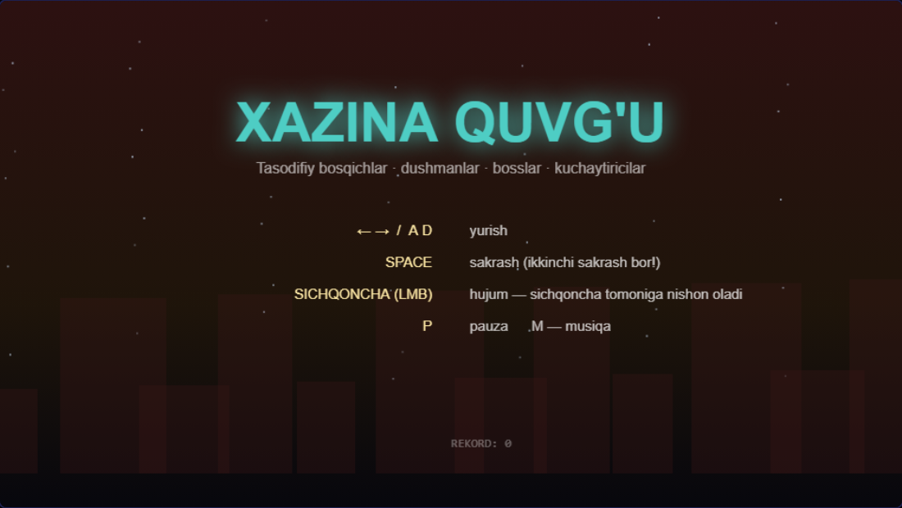
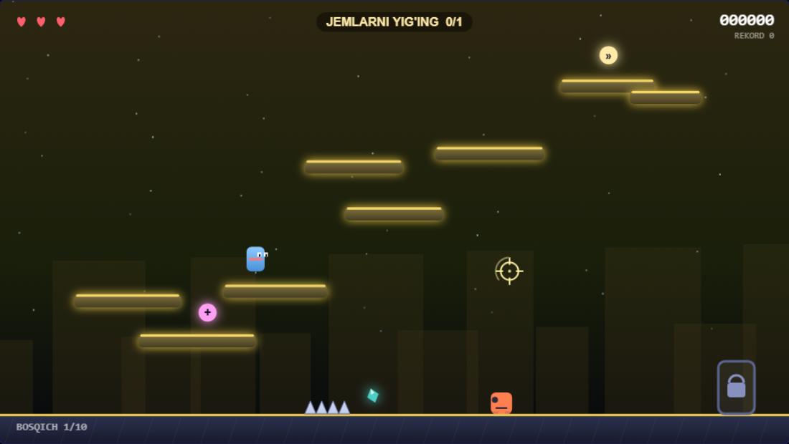
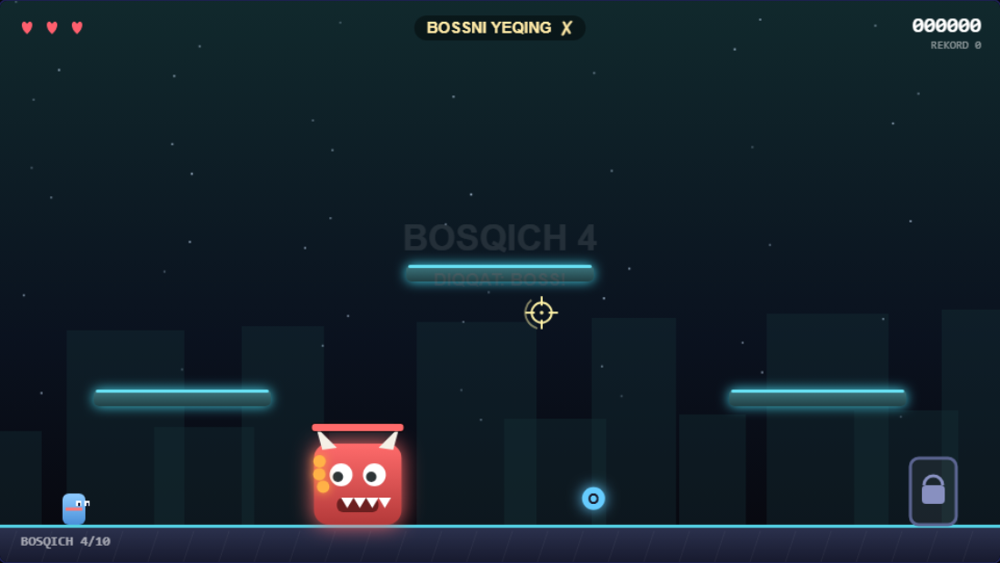
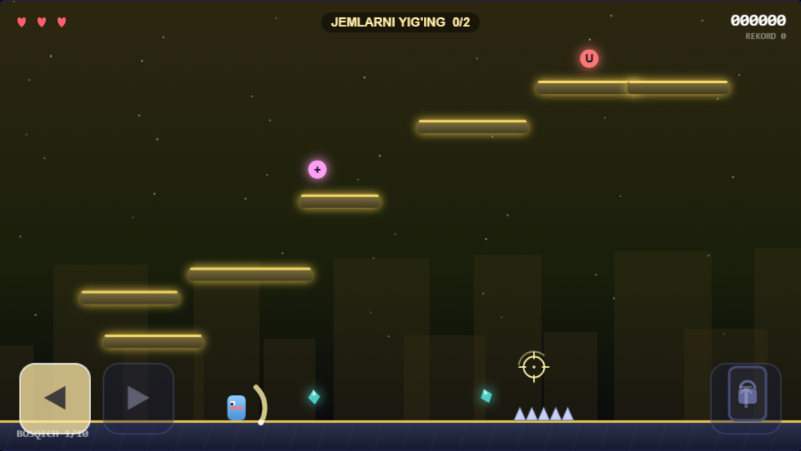
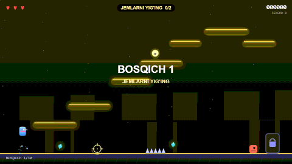
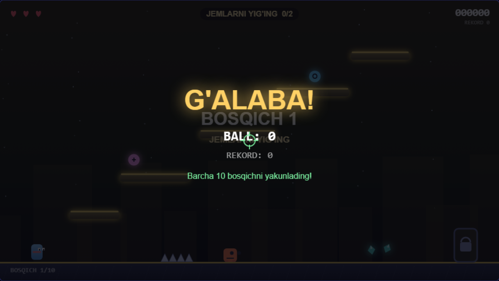

# Xazina Quvg'u (Treasure Chase)

Brauzerda o'ynaladigan arcade-platformer. Har bir bosqich **tasodifiy** yaratiladi:
qimmatbaho toshlar, dushmanlar, shiplar (spikes), kuchaytiricilar va bosslar bor.

O'yin 100% JavaScript — hech qanday kutubxona, server yoki internet kerak emas.

## Media

| | |
|---|---|
|  |  |
| *Menyu* | *Geympley — hujum sichqoncha tomanga nishonlangan* |
|  |  |
| *4-bosqich: boss* | *Telefon: ekran tugmalari* |

**Demo (o'yin jonli yozilgan):**



Yakuniy ekran:



## Ishga tushirish

`index.html` faylini brauzerda oching (ikki marta bosish kifoya):

```
index.html    — sahifa va uslub
game.js       — o'yin mantig'i
test/smoke.js — avtomatik sinovlar
```

Yoki lokal server orqali:

```bash
python -m http.server 8000
# so'ng brauzerda http://localhost:8000 oching
```

## Boshqaruv

| Tugma | Vazifa |
|-------|--------|
| `←` `→` yoki `A` `D` | yurish |
| `Space` / `↑` / `W` | sakrash (yerni tark etgandan keyin yana bosib **ikkinchi sakrash**) |
| **Sichqoncha (chap tugma)** | **hujum** — nishon sichqoncha tomoniga buriladi |
| **Sichqoncha (chap tugma)** | **tasdiqlash** — boshlash, keyingi bosqich, menyuga qaytish |
| `P` / `Esc` | pauza |
| `M` | musiqa yoqish/o'chirish |

> `X` va `J` tugmalari **olib tashlangan** — hujum faqat sichqonchaning
> chap tugmasi bilan. O'yin ichida sichqoncha ko'rinmaydi (cursor yashirilgan):
> o'rniga o'yinning o'z nishoni (crosshair) chiziladi, hujumga tayyor bo'lganda
> u aylanadi.

## Telefon uchun

O'yin to'liq mobilga moslangan — hech qanday o'rnatish shart emas,
brauzerda ochiladi va **ekran tugmalari** paydo bo'ladi:

| Tugma | Vazifa |
|-------|--------|
| `◀` `▶` (chap pastki) | yurish — bosib ushlab turasiz |
| `⤒` (o'ng pastki) | sakrash (qayta bosib = ikkinchi sakrash) |
| ekran bo'sh joyini bosish | nishonlash va **hujum** / tasdiqlash |

Barmoqni tugma ustida sudrab, boshqa joyga olib ketsangiz — bosqich to'xtaydi
(slider kabi ishlaydi). Paneldagi tugmalar faqat `play` holatida ko'rinadi.

## Qoidalar

1. **Maqsad** — har bosqich yuqorida ko'rsatiladi:
   - `JEMLARNI YIG'ING` — barcha qimmatbaho toshlarni yig'ish
   - `BARCHA DUSHMANLARNI YEQING` — maydondagi dushmanlarni yo'q qilish
   - `BOSSNI YEQING` — 4, 8 va 10-bosqichlarda (yakuniy boss)
2. Maqsad bajarilgandan keyin **eshik ochiladi** — uning orqali sichqonchaning chap tugmasini bosib keyingi bosqichga o'tasiz.
3. **Nishon oling** — dushman boshiga sakrab tushish yoki sichqonchani unga tushirib chap tugmani bosish zarar yetkazadi. Hujum yoyi har doim sichqoncha tomoniga nishonlanadi.
4. **Shiplar** va **chuqurliklar** 1 yurak beradi. Yuraklar tugasa — o'yin tugadi.
5. Dushmanlar 20% ehtimol bilan **kuchaytirichi** tashlaydi.

## Kuchaytiricilar

| belgi | nom | ta'siri |
|-------|-----|---------|
| `»` | TEZLIK | 10 soniya tez yurish |
| `O` | DYSTAN | keyingi zararni qaytaradi |
| `U` | MAGNIT | 10 soniya toshlar o'zingizga tortiladi |
| `+` | YURAK | +1 yurak |

## Ball tizimi

- gem: **50**
- dushman: **100** (shooter: 150), boss: **1000**
- kuchaytirichi: **75**
- bosqich yakuni: **300 × bosqich + yurak × 100**
- **Kombo**: ketma-ket urishlar ko'paytiruvchini `x9` gacha oshiradi (3 soniya so'nadi)

Rekord `localStorage`da saqlanadi va menyuda ko'rinadi.

## Bosqichlar

10 bosqich, shundan **4, 8 va 10** — boss bosqichlari. 10-bosqich yakunlansa — `G'ALABA`.

Har bosqichda qiyinlik oshadi: ko'proq dushman, tezroq o'q uchiruvchilar, ko'proq shiplar.

## Sinovlar

```bash
node test/smoke.js
```

Stub'langan brauzer muhitida o'yin mantiig'i simulyatsiya qilinadi:
bosqich generatsiyasi (1..10), fizika, 3000 kadrlik uzoq simulyatsiya,
bosqich yakunlash yo'li, dyustan, o'lim/menyu, rekord, pauza,
boss o'limi -> eshik ochilishi, g'olibalik holati, **sichqoncha boshqaruvi**,
**X/J olib tashlangani** va **M musiqa tugmasi**.

Chrome headless bilan ham tekshirish mumkin:

```bash
chrome --headless=new --disable-gpu --virtual-time-budget=6000 \
  --dump-dom "file:///$PWD/test/browser.html"
# title: OK state=play level=1 ...
```

## Media yaratish

Skrinshotlar va GIF `test/shots.html` + `test/gif-recorder.html` orqali
headless Chrome'da avtomatik yaratiladi:

```bash
CHROME="/c/Program Files/Google/Chrome/Application/chrome.exe"
for s in menu play boss win mobile; do
  "$CHROME" --headless=new --disable-gpu --hide-scrollbars \
    --window-size=1100,620 --virtual-time-budget=5000 \
    --screenshot="media/$s.png" "file:///$PWD/test/shots.html?scene=$s"
done
```

GIF uchun: `npm install omggif`, so'ng `test/gif-recorder.html` sahifasini
`--dump-dom` bilan ochib, `#out` ichidagi base64'ni `media/gameplay.gif` ga
yozasiz (kodlash brauzer ichida bajariladi).
